# miniCycle

Checklists that reset when you finish them.

miniCycle is a free routine manager. You build a list, work through it, and it resets so you can run it again. Each finished run counts as a cycle, and your cycle count is how you see progress over time. It's made for the things you repeat: a morning routine, a workout, a closing shift, a cleaning list.

It works offline and doesn't need an account. Your routines stay on your device.

**[Open miniCycle](https://minicycle.app/app)** · [Product page](https://minicycle.app) · [User manual](https://minicycle.app/legal/user-manual.html) · [Chrome extension](https://chromewebstore.google.com/detail/minicycle/ncfhifaoplaakjpbjokpnblkplcceegi)

<p align="center">
  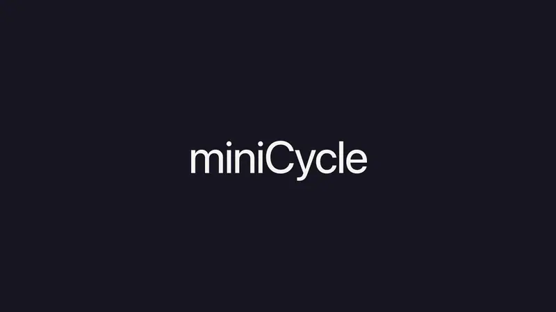
</p>

<p align="center">
  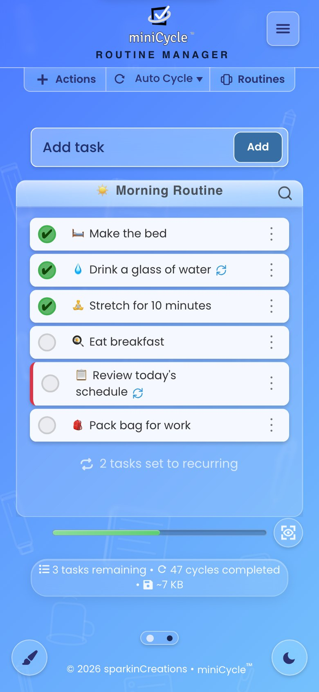
  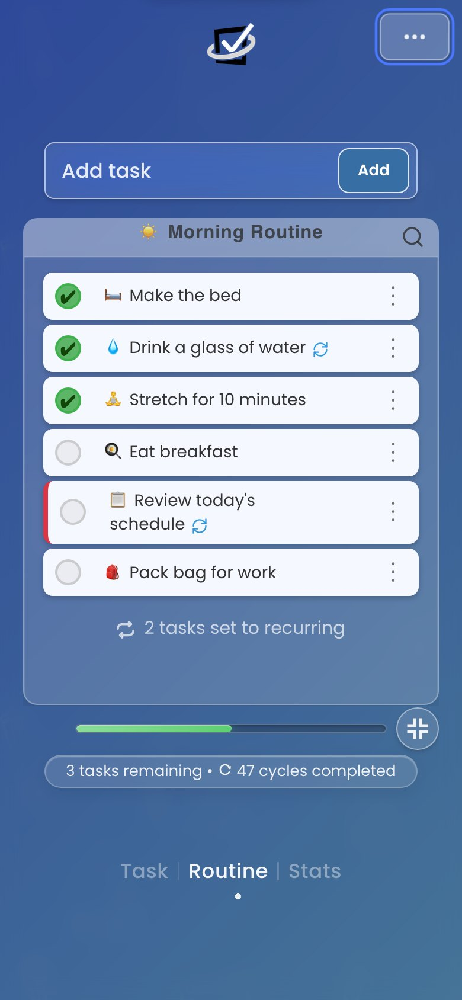
  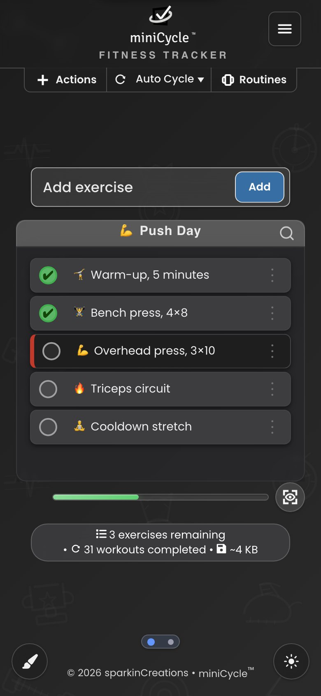
</p>

<p align="center">
  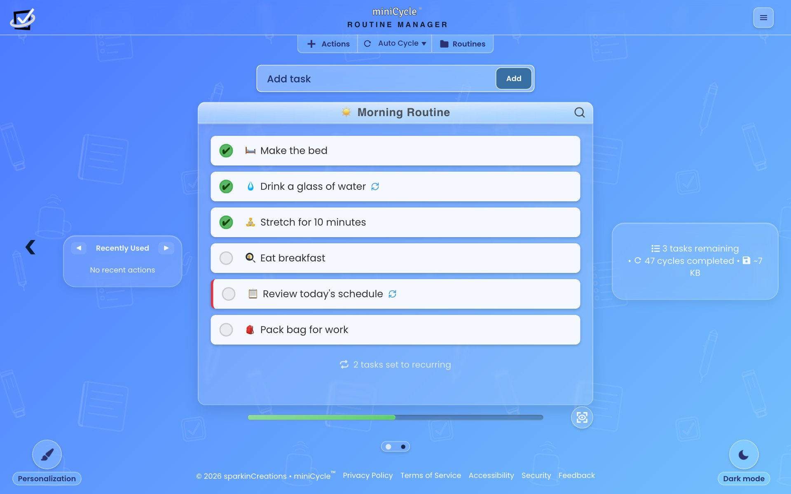
</p>

## Features

### Cycles

Add your tasks and check them off. What happens at the end depends on the mode you pick:

- **Auto Cycle** resets the list as soon as everything is checked.
- **Manual Cycle** waits until you press Complete Cycle.
- **To-Do Mode** clears finished tasks instead of resetting them, for one-off lists.

Each task has its own row of option buttons, and you can choose which ones show.

<p align="center">
  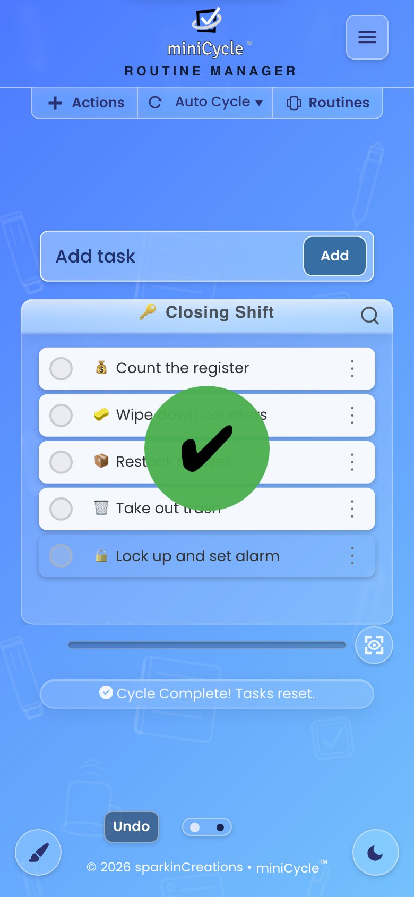
  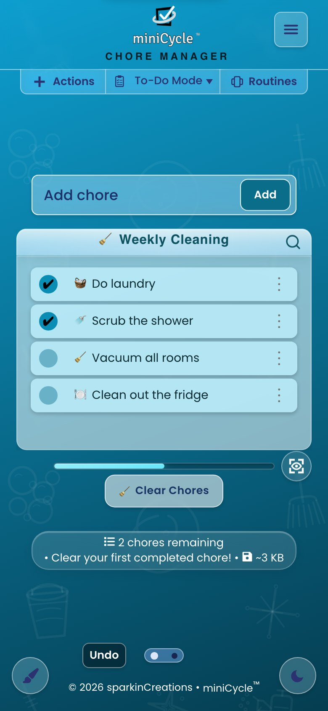
  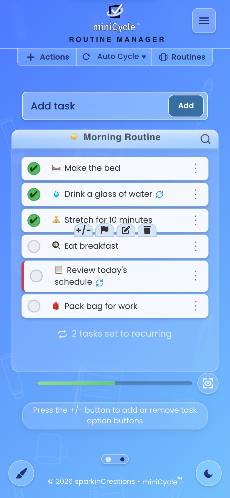
</p>

### Routines

Keep as many routines as you like and switch between them. Each one has its own tasks, cycle count and theme. You can search and sort them, and share one with someone else as a `.mcyc` file ([format details](https://minicycle.app/pages/mcyc-format.html)). There are sample routines to start from if you don't want to begin with a blank list.

<p align="center">
  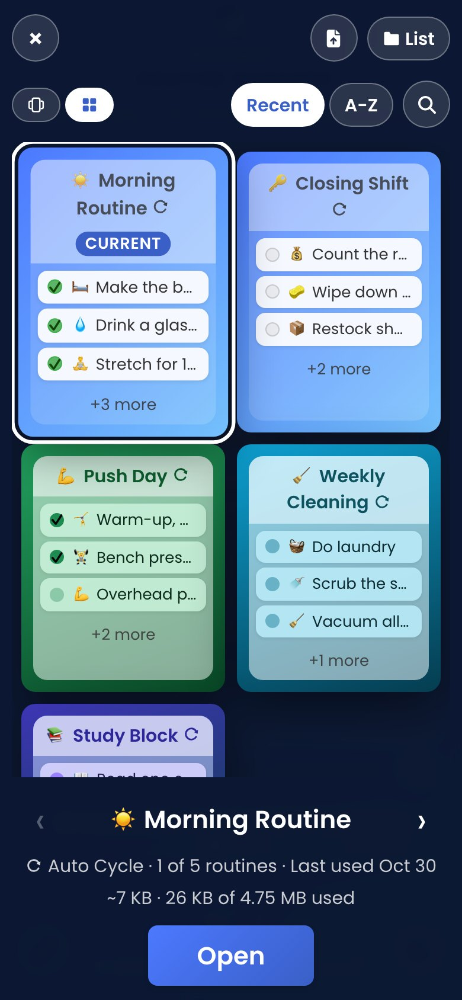
</p>

### Focus View

Focus View hides the header and toolbar so the routine gets the whole screen. It has three tabs: Task shows one task at a time, Routine shows the full list, and Stats shows your progress.

<p align="center">
  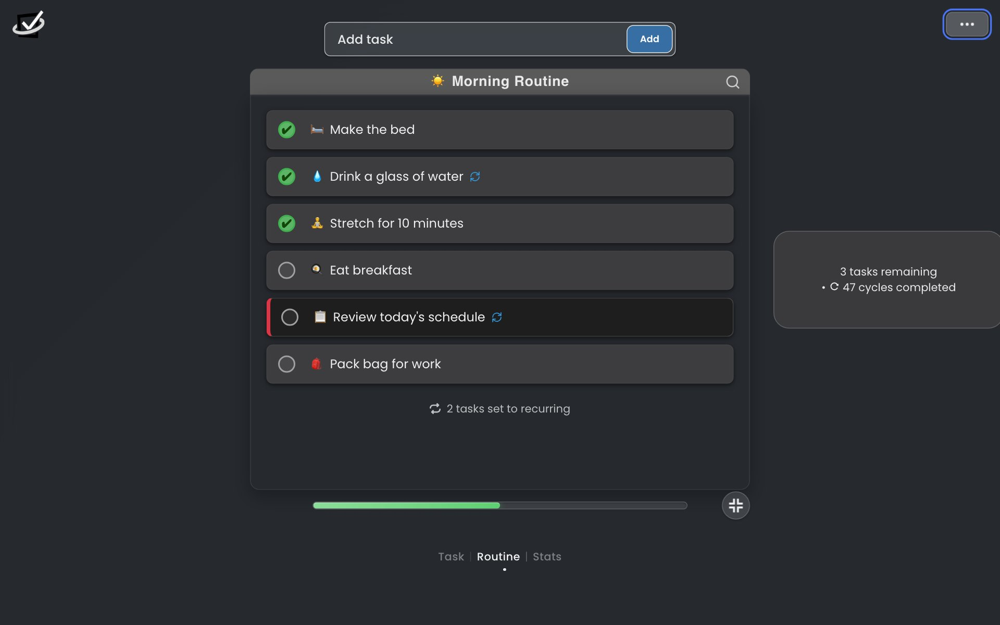
</p>

### Recurring tasks, due dates and reminders

Tasks can come back on a schedule: hourly, daily, weekly, every two weeks, monthly, yearly, or on specific dates. Tasks can also have due dates, which get a badge and are highlighted once they're overdue. Reminders repeat at whatever interval you set.

miniCycle also reminds you to back up every 14 days, every 25 cycles, or every 100 cleared tasks, since your data only lives on your device.

<p align="center">
  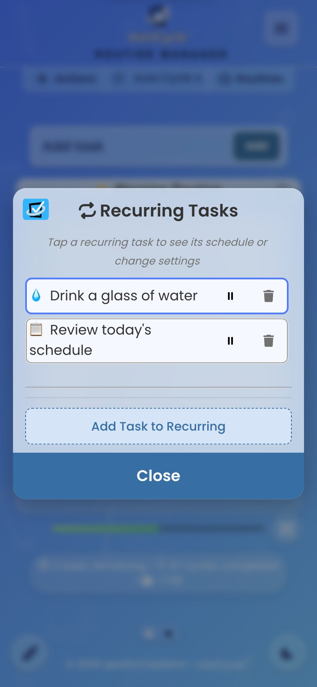
  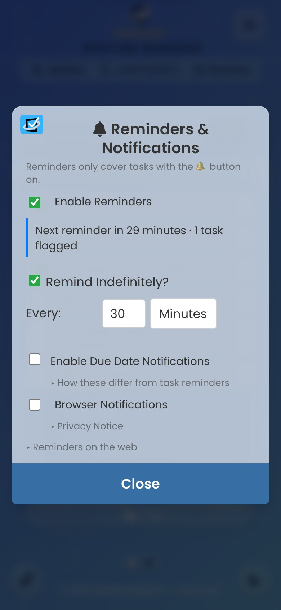
</p>

### Stats and rewards

The Stats panel shows how far along the current cycle is, your cycle count, and your badges. Each routine also keeps a history log and a list of cleared tasks you can restore.

Badges unlock at 5, 25, 50, 75 and 100 cycles, or at a matching number of cleared tasks. The first four unlock vocabulary themes and the last one unlocks a mini-game, Whack-a-Order.

<p align="center">
  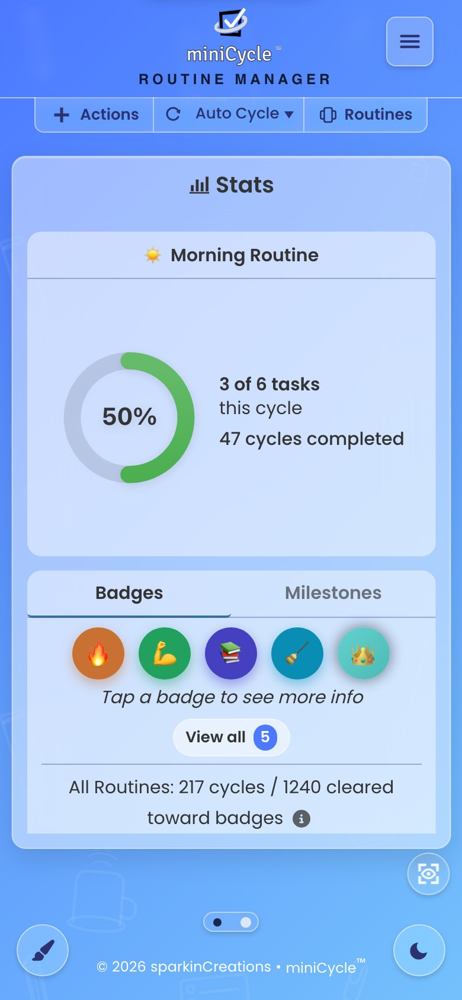
  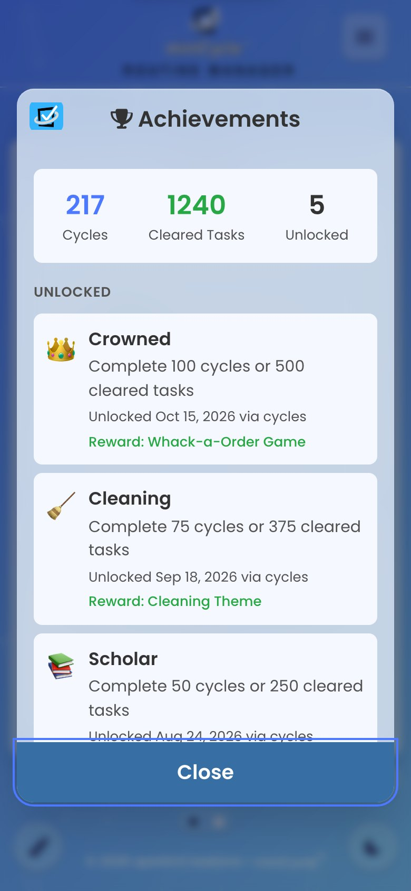
</p>

### Vocabulary themes

A theme changes a routine's colors and the words the app uses for it, so a workout can talk about exercises instead of tasks. Each routine can have its own.

| Theme | Unlocks at | A task is a | A cycle is a |
|---|---|---|---|
| Classic | Start | task | cycle |
| Habit Tracker | 5 cycles | habit | check-in |
| Fitness | 25 cycles | exercise | workout |
| Scholar | 50 cycles | topic | study session |
| Cleaning | 75 cycles | chore | clean sweep |

<p align="center">
  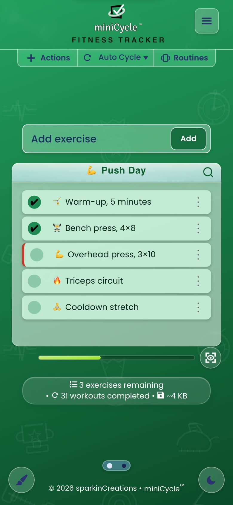
  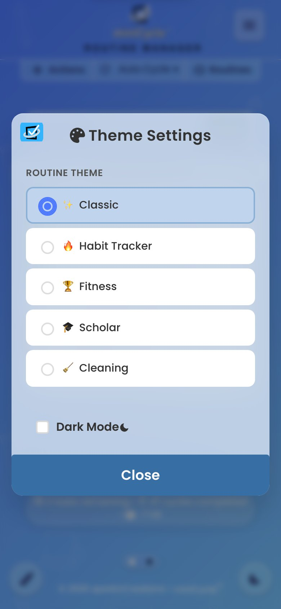
</p>

### Personalization

You can change the colors, save them as presets, set your own background image, and turn on dark mode or let it follow your system. Presets can be imported and exported.

<p align="center">
  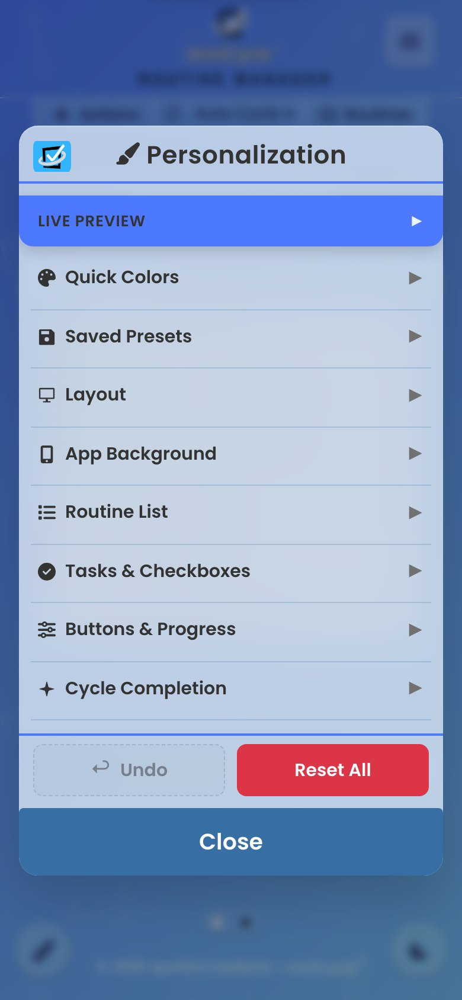
  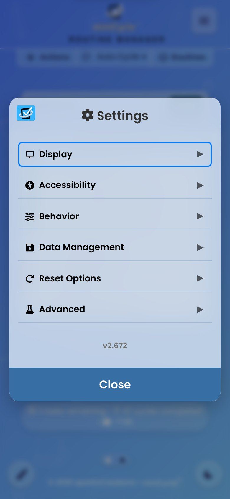
</p>

### Accessibility

miniCycle has a high contrast mode, adjustable font sizes, a reduced motion setting that also follows your system, keyboard navigation, and labels for screen readers. The target is WCAG AA.

CI checks that custom controls are named and keyboard-operable, and runs axe color contrast checks per theme and view. Zoom and actual screen reader behavior are still tested by hand.

### Also included

- Search and filter tasks by name, status, priority, due date or recurring, and sort them
- Reorder by dragging or with arrow buttons
- Undo and redo (Ctrl+Z / Cmd+Z), plus keyboard shortcuts for common actions
- A customizable Quick Actions menu
- 14 guided tours
- Full backup and restore

<p align="center">
  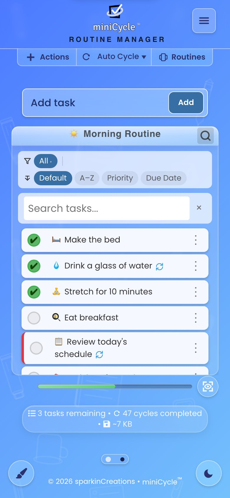
  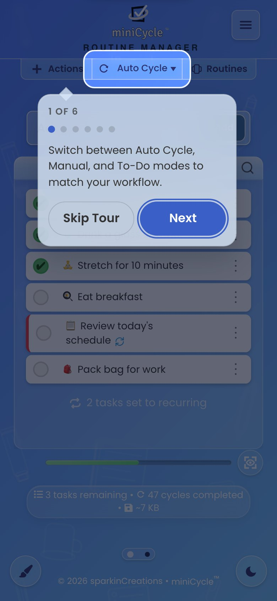
</p>

## Where it runs

- **Browser:** [minicycle.app/app](https://minicycle.app/app). You can install it as a PWA from there and use it offline.
- **Chrome:** [miniCycle](https://chromewebstore.google.com/detail/minicycle/ncfhifaoplaakjpbjokpnblkplcceegi) opens in the side panel. [miniCycle Lite](https://chromewebstore.google.com/detail/minicycle-lite/mfbedmndcmhileaofjfmepcgofdipeeo) is the smaller version.
- **iOS, Android, macOS, Windows:** this repo has Capacitor and Electron builds that wrap the same web app.
- **Older devices:** browsers below Chrome 80, Safari 13.1 or Firefox 74 are sent to [Lite](https://minicycle.app/lite/miniCycle-lite.html), a separate version that doesn't need modern JavaScript.

**Privacy:** the app has no accounts, analytics or tracking. The marketing pages count button clicks with a self-hosted counter that stores no personal data. Details are in the [privacy policy](https://minicycle.app/legal/privacy.html).

## How it's built

miniCycle is plain JavaScript with no framework. I wanted to understand each layer, so I built the pieces a framework would normally hand you:

- **Dependency injection.** Modules declare what they need in `diBase.js`, and manifests wire them together at boot. That avoids circular imports and shared globals, and it lets each module be tested on its own.
- **Labels.** User-facing text goes through `getLabel()`, which handles plurals and variables. It's also what makes vocabulary themes possible, since a theme can override any label for one routine.
- **Boot phases.** `orchestrator → coreBoot → featureBoot → uiBoot` makes sure state exists before modules are wired, and modules are wired before the UI renders.
- **State.** All writes go through `AppState.update()`, which handles saving and undo.
- **CSS tokens.** Colors, spacing and type live in `styles/base/variables.css`, and dark mode and themes override those values.
- **Offline and releases.** A service worker serves the app from cache. Release builds use esbuild and content-hashed filenames, and there's no build step for development.
- **Security.** Inline scripts are allowed by hash through CSP, with no `'unsafe-inline'` for scripts in the app. User text is rendered with `textContent`.

If you want the details, start with [How miniCycle Works](web/docs/start-here/HOW_MINICYCLE_WORKS.md) or the [architecture docs](web/docs/architecture/ARCHITECTURE_OVERVIEW.md).

| | |
|---|---|
| App modules | 176 (about 110,000 lines) |
| CSS | 45 files (about 32,000 lines) |
| Browser tests | 4,208 |
| Label strings | about 2,100 |

These were accurate at version 2.672. The test count measures tests that pass, and code coverage isn't measured. Current numbers are in [PROJECT_STATS.md](web/docs/PROJECT_STATS.md).

## Development

You'll need Node.js and Python 3.

```bash
git clone https://github.com/sparkinCreations/miniCycle.git
cd miniCycle/web
npm install
npm start
```

Then open http://localhost:8080/miniCycle.html.

```bash
npm test             # browser tests (needs npm start running)
npm run test:journey # end-to-end flows on the real app
npm run test:layout  # layout and overlap checks
npm run test:sw      # offline boot
npm run test:a11y    # keyboard and naming checks
npm run test:contrast
npm run lint
npm run build:web    # release bundle in web/dist
```

Those suites and the `validate:*` scripts also run in GitHub Actions. [VALIDATION_GATES.md](web/docs/working-on-code/VALIDATION_GATES.md) explains each check.

```
web/       the app, its tests and its docs
chrome/    Chrome extensions (full is generated from web/, Lite is hand-built)
mobile/    iOS and Android apps (Capacitor)
desktop/   macOS and Windows app (Electron)
shared/    reserved for cross-platform code, currently empty
```

## Contributing

Contributions are welcome. The license is view-only, so you'll need written permission before forking. Open an issue about what you'd like to work on and you can get that there. [CONTRIBUTING.md](CONTRIBUTING.md) has the rest, and [FIRST_CONTRIBUTION.md](web/docs/start-here/FIRST_CONTRIBUTION.md) walks through a first pull request.

## License

miniCycle is source-available under a proprietary license. You can read and study the code, but you can't copy, modify, distribute or reuse it in other projects. See [LICENSE](LICENSE).

## About

miniCycle is made by [sparkinCreations](https://sparkincreations.com). [TaskCycle](https://taskcycle.app) and [MasterMath](https://mastermath.app) are also from the studio.

Found a bug or have an idea? [Open an issue](https://github.com/sparkinCreations/miniCycle/issues).
